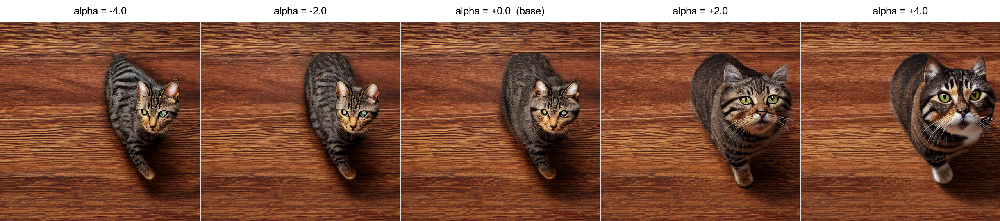
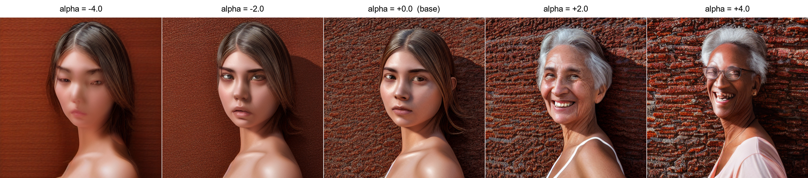
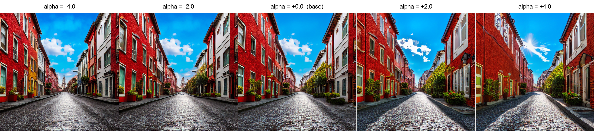

# Concept Sliders —— 复现与自训练滑块

复现 [Concept Sliders: LoRA Adaptors for Precise Control in Diffusion Models (ECCV 2024)](https://github.com/rohitgandikota/sliders) 的官方实现,并在此基础上训练了三个自己的概念滑块: **猫的胖瘦**、**笑容强度**、**天气氛围**。

全部效果均由我训练出的 LoRA 权重、在 `CompVis/stable-diffusion-v1-4` 上推理生成,未做挑选或后期处理。权重已包含在本仓库中,`git clone` 后即可直接复现。

---

## 目录

- [我做了什么](#我做了什么)
- [效果展示](#效果展示)
- [复现中定位并修复的一个问题](#复现中定位并修复的一个问题)
- [已知局限:笑容滑块的年龄纠缠](#已知局限笑容滑块的年龄纠缠)
- [训练配置](#训练配置)
- [本地推理](#本地推理)
- [环境](#环境)
- [上游文档](#上游文档)
- [引用与许可](#引用与许可)

---

## 我做了什么

本仓库 fork 自官方实现。上游的训练/推理代码我未做功能性改动,我的工作集中在以下几块:

| 内容 | 位置 |
|---|---|
| 三个自训练的概念滑块权重 | [models/](models/) |
| 三个滑块的训练提示词配置 | [trainscripts/textsliders/data/prompts.yaml](trainscripts/textsliders/data/prompts.yaml)、[trainscripts/imagesliders/data/prompts.yaml](trainscripts/imagesliders/data/prompts.yaml) |
| 批量推理 + 对比图生成脚本 | [generate_slider_demos.py](generate_slider_demos.py) |
| 推理过程中定位并修复的 LoRA 模块集不匹配问题 | [generate_slider_demos.py:32-38](generate_slider_demos.py#L32-L38) |
| 三个滑块的效果对比图 | [images/](images/) |

每个滑块的对比图固定同一个 prompt、同一个随机种子(888)、同一条采样轨迹,**只改变滑块的 alpha 值**。alpha = 0 是未加滑块的基座模型,作为对照组;alpha 为负表示施加反向概念。

## 效果展示

### 1. 猫的胖瘦

```
target: "cat"   positive: "fat cat"   unconditional: "skinny cat"   neutral: "cat"
```



alpha 从 -4 到 +4 连续变化,猫的体型和镜头距离单调变化,负向侧明显变瘦、正向侧明显变壮。除体型外,姿态、木地板纹理、画面构图基本保持稳定。

### 2. 笑容强度

```
target: "person"   positive: "smiling person,big smile, laughing"   unconditional: "sad people ,crying,frowning"
```



笑容确实随 alpha 单调增强。但这个滑块同时存在**年龄纠缠**问题,见下方[已知局限](#已知局限笑容滑块的年龄纠缠)一节 —— 这一栏刻意保留了完整范围,没有为了好看而裁掉。

### 3. 天气氛围

```
target: "weather"   positive: "bright pleasant weather"   unconditional: "weather"   neutral: "weather"
```



从阴天街道到强烈日照,光照方向、天空饱和度和阴影强度都随之变化。这个滑块的概念边界最干净,alpha 拉到 ±4 也没有破坏建筑结构。

## 复现中定位并修复的一个问题

**现象**:用仓库自带的 `LoRANetwork` 加载自己训练出的权重,直接报 `state_dict` 键不匹配:

```
RuntimeError: Error(s) in loading state_dict for LoRANetwork:
    Unexpected key(s) in state_dict: "lora_unet_down_blocks_0_downsamplers_0_conv.alpha", ...
```

**排查**:对比两边的模块数量。

- 训练产出的 checkpoint 里有 **150** 个 LoRA 模块:64 个 Attention + 58 个 ResnetBlock2D 卷积 + 22 个 time_emb_proj + 3 个 Downsample2D + 3 个 Upsample2D。
- 但 `LoRANetwork.__init__` 里写死了 `DEFAULT_TARGET_REPLACE`(= `["Attention"]`,64 个模块),而调用它的 `create_modules` 本身是接受 `target_replace_modules` 参数的。

也就是说,训练脚本里计算好的 `modules = DEFAULT_TARGET_REPLACE + UNET_TARGET_REPLACE_MODULE_CONV` 这个变量,从来没有被传进 `LoRANetwork`。于是运行时只会建出 64 个模块,和权重里的 150 个对不上。

**修复**:构建网络前先把 `DEFAULT_TARGET_REPLACE` 拓宽成完整的 c3lier 模块集,`load_state_dict` 随即通过([generate_slider_demos.py:32-38](generate_slider_demos.py#L32-L38))。

因为三个滑块都复用了同一份加载逻辑,修复一处后三者都能正常推理。

## 已知局限:笑容滑块的年龄纠缠

上面那张笑容对比图里可以看到:alpha 到 +2 之后,**人物不只笑容变强,年龄也一起变了** —— 从年轻女性变成老年女性。这是典型的 **concept bleeding(概念纠缠)**,滑块学到的方向向量里混进了"笑容"以外的语义分量。

**归因。** 问题出在训练提示词的构造上:

```
positive:      "smiling person,big smile, laughing"
unconditional: "sad people ,crying,frowning"
neutral:       "person"
```

滑块学习的方向是 `positive - unconditional` 的差值方向。但这组提示词的对比在两个概念上同时成立 —— **表情**(笑 vs 哭)和**效价/情绪状态**(frowning 与 crying 携带的负面语义)。"crying" 在 SD 的图文空间里并不只有"不笑"这一个含义,它同时还关联到年龄、性别、面貌状态等属性,这些分量被一并编码进了滑块方向。

作为对照,天气滑块用的是 `"bright pleasant weather"` vs `"weather"`,对比是在**同一个概念的同一个维度**上做的,所以边界干净、拉满 ±4 也不崩。这反过来说明问题不在滑块方法本身,而在提示词把两个概念耦合在了一起。

**改进方向**(尚未实施):把对比收敛到单一维度上,避免引入情绪效价 ——

```
positive:      "person with a big smile"
unconditional: "person with a neutral expression"
neutral:       "person"
```

同时可以适当调低 `guidance_scale`,并借助训练脚本已有的 `--attributes` 参数做属性解耦(该参数原本就是为"年龄滑块会把老人全变成男性"这类纠缠设计的)。

## 训练配置

三个滑块共用同一套基础超参,来自 [trainscripts/textsliders/data/config.yaml](trainscripts/textsliders/data/config.yaml)(权重文件名里的 `alpha1.0_rank4_noxattn` 即对应此处的 `network` 段):

| 项 | 值 |
|---|---|
| 基座模型 | `CompVis/stable-diffusion-v1-4` |
| 网络类型 | `c3lier` |
| rank / alpha | 4 / 1.0 |
| 训练方式 | `noxattn`(不训练 cross-attention 与 time-embedding) |
| 优化器 / 学习率 | AdamW / 2e-4,constant |
| 迭代步数 | 1000(`per_steps: 500`,因此每个滑块有 500 步和 last 两份权重) |
| 精度 | bfloat16 |

每个滑块的提示词配置见 [trainscripts/textsliders/data/prompts.yaml](trainscripts/textsliders/data/prompts.yaml) 与 [trainscripts/imagesliders/data/prompts.yaml](trainscripts/imagesliders/data/prompts.yaml)。

## 本地推理

[generate_slider_demos.py](generate_slider_demos.py) 是我写的独立推理脚本:对每个滑块固定 prompt 与种子,扫一组 alpha 值,拼成带标注的对比图。

```bash
# 生成全部三个滑块
python generate_slider_demos.py

# 只生成指定滑块
python generate_slider_demos.py --sliders fatcat weather
```

输出写到 `images/demo_<name>.png`。脚本默认走本地 HuggingFace 缓存(`HF_HUB_OFFLINE=1`);首次运行请先让 `CompVis/stable-diffusion-v1-4` 下载完整。

权重位于 [models/](models/),命名格式为 `<名称>_alpha1.0_rank4_noxattn_{500steps,last}.safetensors`,两者效果相近,复现下图使用的是 `_500steps` 版本。

## 环境

```bash
conda create -n sliders python=3.9
conda activate sliders
pip install -r requirements.txt
```

本仓库实验环境:Python 3.9 / PyTorch 2.0.1+cu118 / diffusers 0.20.2 / transformers 4.27.4,单卡 RTX 4060 Laptop (8GB) 完成训练与推理。

## 上游文档

以下为官方仓库原有的说明,折叠保留以便查阅。

<details>
<summary>展开查看上游原始文档</summary>

### 链接

[项目主页](https://sliders.baulab.info) | [论文](https://arxiv.org/pdf/2311.12092.pdf) | [官方训练好的滑块](https://sliders.baulab.info/weights/xl_sliders/) | [Colab Demo](https://colab.research.google.com/github/rohitgandikota/sliders/blob/main/demo_concept_sliders.ipynb) | [HuggingFace Demo](https://huggingface.co/spaces/baulab/ConceptSliders)

<div align='center'>

</div>

### Textual Concept Sliders

编辑 `trainscripts/textsliders/data/prompts.yaml` 中的 `target` / `positive` / `unconditional` / `neutral` / `action`,然后运行:

```
python trainscripts/textsliders/train_lora.py --attributes 'male, female' --name 'ageslider' --rank 4 --alpha 1 --config_file 'trainscripts/textsliders/data/config.yaml'
```

`--attributes` 用于解耦概念。例如年龄滑块会让所有老人变成男性,传入 `"female, male"` 可以缓解。

SD-XL 版本使用 `train_lora_xl.py` 与 `SDXL-sliders-inference.ipynb`。

### Visual Concept Sliders

图像滑块需要准备 4-6 组"编辑前/编辑后"的配对图片,分别存入两个子目录,然后运行:

```
python trainscripts/imagesliders/train_lora-scale.py --name 'eyeslider' --rank 4 --alpha 1 --config_file 'trainscripts/imagesliders/data/config.yaml' --folder_main 'datasets/eyesize/' --folders 'bigsize, smallsize' --scales '1, -1'
```

### FLUX 支持

FLUX-1 的滑块训练为实验性功能,需先安装 `pip install -r flux-sliders/flux-requirements.txt`,再打开 `flux-sliders` 目录下的 notebook。

### 用 GPT 生成提示词

见 [GPT_prompt_helper.ipynb](GPT_prompt_helper.ipynb),可用任意 OpenAI 模型根据自然语言描述生成滑块提示词。

### 真实图像编辑

使用 null inversion 编辑真实图片,见 `demo_image_editing.ipynb`。

### 本地运行 Gradio Demo

```
git lfs install
git clone https://huggingface.co/spaces/baulab/ConceptSliders
cd ConceptSliders
pip install requirements.txt
python app.py
```

</details>

## 引用与许可

本仓库代码基于官方实现,原论文作者为 Rohit Gandikota 等人:

```bibtex
@inproceedings{gandikota2023erasing,
  title={Erasing Concepts from Diffusion Models},
  author={Rohit Gandikota and Joanna Materzy\'nska and Tingrui Zhou and Antonio Torralba and David Bau},
  booktitle={Proceedings of the 2024 IEEE European Conference on Computer Vision},
  note={arXiv preprint arXiv:2311.12092},
  year={2024}
}
```

**License.** 本仓库代码沿用上游的 MIT 协议,见 [LICENSE](LICENSE)。注意所使用的基座模型(`CompVis/stable-diffusion-v1-4`)另有其自身的许可条款,请单独查阅。
